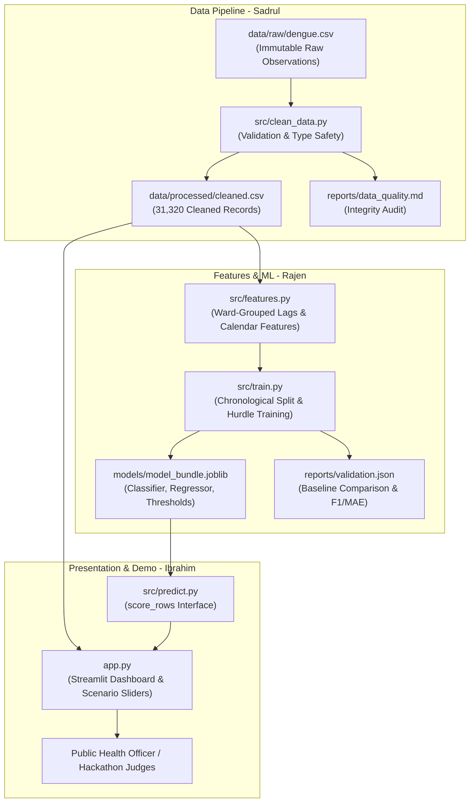

# Urban Dengue Risk Intelligence Dashboard

*   **Author:** Rajen (Technical Lead), Sadrul (Data Cleaning), Ibrahim (Dashboard & Demo)
*   **Status:** Draft
*   **Date:** 2026-11-21

--------------------------------------------------------------------------------

## Overview

The Urban Dengue Risk Intelligence Dashboard is a ward-level weekly dengue outbreak surveillance and decision-support system for five major cities in Bangladesh: Chattogram, Dhaka North, Dhaka South, Gazipur, and Narayanganj. The system integrates historical meteorological records (rainfall, temperature, humidity) with ward vulnerability indicators (population density, waterlogging index, sanitation score) to estimate immediate outbreak probabilities and expected caseloads.

Designed for rapid localhost deployment and verifiable reproducibility, the system isolates data preparation, feature engineering/modeling, and interactive visualization behind deterministic interface contracts.

--------------------------------------------------------------------------------

## The Problem

Urban dengue transmission in Bangladesh exhibits pronounced seasonal surges driven by monsoon rainfall, stagnant water accumulation, and high vector density. Municipal health departments and vector control teams face two operational challenges:

1. **Delayed Intervention:** Control measures often begin only after clinical admissions peak in hospitals, missing the critical larval breeding window.
2. **Statistical Zero-Inflation:** Over 58% of weekly ward observations record zero dengue cases. Conventional regression models trained on Mean Squared Error minimize loss by predicting near-zero across all weeks, failing to detect true outbreak clusters and providing little operational guidance for preventative fogging or larvicide deployment.

The proposed solution provides a localized risk nowcasting pipeline that combines a hurdle modeling strategy (classifying positive-outbreak probability and predicting case severity conditional on presence) with a Streamlit dashboard. This enables municipal officers to identify emerging high-risk wards using preceding weather conditions without runtime model training.

--------------------------------------------------------------------------------

## Goals

*   **G1: Deterministic End-to-End Pipeline:** Construct an automated, localhost pipeline running under Python 3.11 with zero external cloud API dependencies.
*   **G2: Temporal and Spatial Feature Integrity:** Compute 1- to 4-week rainfall lags, rolling totals, and environmental indicators strictly grouped by `ward_id` to prevent cross-ward contamination and temporal data leakage.
*   **G3: Zero-Inflated Outbreak Modeling:** Implement and evaluate a two-stage hurdle model against an all-zero baseline, optimizing recall and F1 on positive-case weeks alongside standard MAE/RMSE.
*   **G4: Deterministic Inference Contract:** Expose `score_rows(df: pd.DataFrame) -> pd.DataFrame` in `src/predict.py` yielding `ward_id`, `date`, `p_nonzero`, `expected_cases`, and categorical `risk_tier` (Low, Medium, High, Critical).
*   **G5: Verifiable Reproducibility:** Ensure automated tests validate key uniqueness, physical bounds, lag boundary conditions, and inference outputs, saving empirical validation metrics to `reports/validation.json`.

--------------------------------------------------------------------------------

## Non-Goals

*   **NG1: Multi-Month Dynamical Forecasting:** The system does not attempt long-range transmission projections (e.g., SEIR epidemiological compartmental models); it provides a weekly risk estimate for the observation week based on observed weather history.
*   **NG2: Distributed / Microservice Overhead:** Distributed message queues, containerization (Docker), relational database servers (PostgreSQL), and separate API backends (FastAPI) are excluded to ensure fast localhost execution.
*   **NG3: Data Fabrication:** The pipeline will not synthesize synthetic records or forward-fill missing intervals across calendar gaps.
*   **NG4: Runtime Model Retraining:** Streamlit interactions will never trigger model retraining; inference relies strictly on serialized artifacts (`models/model_bundle.joblib`).

--------------------------------------------------------------------------------

## Open Questions

*   **Q1: Initial 4-Week Truncation Strategy:** Calculating 1- to 4-week rainfall lags leaves the first 4 observation weeks of each ward with incomplete lag history (240 ward-weeks out of 31,320). We must determine whether to truncate the initial 4 weeks per ward or apply an explicit backfill policy without future leakage.
*   **Q2: Fixed vs. Empirical Risk Tier Thresholds:** How the boundaries between Low, Medium, High, and Critical risk tiers will be calibrated so they remain stable across seasonal lows and peak transmission months.
*   **Q3: Git Repository Initialization:** Whether to initialize a local Git repository immediately in `e:\operation-mosha` to enable branch isolation (`feature/model-pipeline`) prior to remote GitHub URL configuration.

--------------------------------------------------------------------------------

## Critical User Journeys (CUJs)

### CUJ 1: Public Health Officer Weekly Ward Risk Triage

*   **Given**: Cleaned weekly ward records in `data/processed/cleaned.csv` and serialized model in `models/model_bundle.joblib`.
*   **When**: The officer selects a city, ward, and target observation date in the Streamlit interface.
*   **Then**: The application renders the current risk tier badge (Low, Medium, High, Critical), expected case count, probability of non-zero outbreak, and preceding 4-week rainfall trends without perceptible latency.

### CUJ 2: Scenario Simulation & Weather Sensitivity Check

*   **Given**: A selected ward and week with baseline meteorological inputs.
*   **When**: The user modifies rainfall or temperature sliders in the dashboard sidebar to simulate sudden monsoon downpours.
*   **Then**: The dashboard recomputes the feature vector for that specific week, executes `score_rows`, and displays updated risk tiers and expected cases immediately.

### CUJ 3: Engineering Reproduction & Test Verification

*   **Given**: A cloned repository and installed `requirements.txt`.
*   **When**: An evaluator runs data validation, training, and pytest commands.
*   **Then**: Data audit passes, `src/train.py` completes training and saves the bundle, and all feature and leakage tests in `tests/` pass.

--------------------------------------------------------------------------------

## Technical Plan (Architecture)

### Architectural Overview

The system operates as a modular, file-based pipeline with separated concerns across data preparation, feature transformation, model training/inference, and visual presentation. All inter-component state transfer occurs through explicit file artifacts and standardized in-memory signatures.



### Subsystem Design & Interfaces

#### 1. Data Cleaning & Validation Subsystem (`src/clean_data.py`)
- **Inputs:** `data/raw/dengue.csv`
- **Outputs:** `data/processed/cleaned.csv`, `reports/data_quality.md`
- **Invariants:**
  - `(ward_id, date)` constitutes a unique primary key.
  - Zero-case records are preserved unconditionally (reflecting genuine non-outbreak periods).
  - Physical ranges validated: `rainfall_mm >= 0`, `0 <= relative_humidity_pct <= 100`, `min_temp_c <= avg_temp_c <= max_temp_c`, indices $\in [0, 1]$.
  - Temporal continuity verified per ward: 522 contiguous weekly intervals from 2016-01-04 to 2025-12-29.

#### 2. Feature Engineering Pipeline (`src/features.py`)
- **Primary Function:** `create_features(df: pd.DataFrame, is_training: bool = False) -> pd.DataFrame`
- **Lag Mechanics:**
  - Grouping: Strict per-`ward_id` partitioning. Sorting: `ward_id` ASC, `date` ASC.
  - Rainfall lags: $t-1, t-2, t-3, t-4$ weeks via `.groupby('ward_id')['rainfall_mm'].shift(k)`.
  - Cumulative rainfall: 2-week sum ($\sum_{k=1}^2 \text{rainfall}_{t-k}$) and 4-week sum ($\sum_{k=1}^4 \text{rainfall}_{t-k}$).
  - Temperature & humidity: lag-1 `avg_temp_c`, lag-1 `relative_humidity_pct`, and diurnal range (`max_temp_c - min_temp_c`).
  - Vulnerability & Seasonality: `population_density_sqkm`, `water_logging_risk_index`, `sanitation_score`, and cyclical epidemiological week encoding ($\sin(2\pi \cdot \text{week}/52), \cos(2\pi \cdot \text{week}/52)$).
- **Leakage Prevention & Edge Handling:**
  - For training: Rows with undefined 4-week lag history (the first 4 observation weeks of each ward, $N = 240$) are cleanly dropped rather than imputed with future data.
  - Target isolation: `dengue_cases` is strictly reserved as label $y$ and is never included in the feature matrix $X$.

#### 3. Modeling & Evaluation Pipeline (`src/train.py`)
- **Temporal Splitting Strategy:**
  - Training Set: 2016-01-04 through 2022-12-26 (~70% temporal horizon).
  - Validation Set: 2023-01-02 through 2024-12-30 (~20% temporal horizon).
  - Held-out Test Set: 2025-01-06 through 2025-12-29 (~10% temporal horizon).
  - No random cross-validation or future-to-past data leakage.
- **Model Architecture (Two-Stage Hurdle):**
  - **Stage 1 (Occurrence Classifier):** `LogisticRegression` or `GradientBoostingClassifier` trained on binary label $y_{\text{bin}} = \mathbb{I}(y > 0)$, producing estimated outbreak probability $p = P(y > 0 \mid X)$.
  - **Stage 2 (Severity Regressor):** `HistGradientBoostingRegressor` or `PoissonRegressor` trained exclusively on positive-case records ($y > 0$), predicting conditional count $\hat{y}_{\text{pos}} = E[y \mid y > 0, X]$.
  - **Expected Case Formulation:**
    $$\hat{E}[y \mid X] = p \times \hat{y}_{\text{pos}}$$
    with hard clipping at zero ($\max(0, \hat{E}[y \mid X])$).
- **Evaluation & Baseline Benchmarking:**
  - All-Zero Baseline benchmarked on every split.
  - Metrics computed: MAE, RMSE, Non-Zero Precision, Non-Zero Recall, and Non-Zero F1 score.
  - Output serialized to `reports/validation.json`.
- **Bundle Packaging:**
  - `models/model_bundle.joblib` persists a dictionary containing:
    - `classifier`: Fitted Stage 1 model.
    - `regressor`: Fitted Stage 2 model.
    - `feature_names`: Exact ordered list of input feature names.
    - `thresholds`: Calibrated risk-tier boundaries.
    - `metadata`: Training timestamp, evaluation metrics, and dataset hash.

#### 4. Inference Contract (`src/predict.py`)
- **Signature:** `score_rows(df: pd.DataFrame) -> pd.DataFrame`
- **Execution Flow:**
  1. Validates input schema.
  2. Constructs lag and calendar features using internal feature pipeline logic.
  3. Loads serialized `model_bundle.joblib` (or raises an explicit `FileNotFoundError` with remediation instructions if missing).
  4. Generates $p_{\text{nonzero}}$ and $\hat{E}[\text{cases}]$.
  5. Maps outputs to categorical `risk_tier` (Low, Medium, High, Critical) based on fixed policy thresholds:
     - **Low:** $p < 0.25$ and $\hat{E} < 1.0$
     - **Medium:** $0.25 \le p < 0.50$ or $1.0 \le \hat{E} < 3.0$
     - **High:** $0.50 \le p < 0.75$ or $3.0 \le \hat{E} < 8.0$
     - **Critical:** $p \ge 0.75$ or $\hat{E} \ge 8.0$
  6. Returns DataFrame containing columns: `[ward_id, date, p_nonzero, expected_cases, risk_tier]`.

#### 5. User Interface & Scenario Exploration (`app.py`)
- **Technology:** Streamlit + Plotly.
- **Resource Caching:** `@st.cache_data` for raw/cleaned CSV reading; `@st.cache_resource` for model bundle loading to avoid disk re-reads.
- **Dynamic Scenario Re-scoring:** When user adjusts temperature or rainfall sliders, the dashboard clones the selected ward's historical lag sequence, substitutes the modified values for the target week, invokes `score_rows(modified_df)`, and updates visual indicators instantly.
- **Graceful Fallback:** If `model_bundle.joblib` has not been generated, renders a prominent "Model not trained yet" informational card rather than crashing.

--------------------------------------------------------------------------------

## Alternatives Considered

### Alternative A: Single Continuous Regressor on Raw Counts

*   **Pros:** Simpler modeling pipeline with a single estimator (e.g., standard Ridge or Random Forest Regressor) predicting continuous caseloads directly.
*   **Cons:** Severely penalized by zero-inflation (58.03% zero-case weeks). Standard squared error loss pushes predictions toward zero to minimize global penalty, yielding poor recall on genuine outbreak events and generating fractional outputs that fail to communicate outbreak risk.
*   **Reason for Rejection:** `Rejected by author: Collapses positive outbreak recall under heavy zero-inflation; fails to identify emerging disease clusters.`

### Alternative B: Microservice Stack (FastAPI + React + PostgreSQL + Docker)

*   **Pros:** Enforces strict boundary between API and frontend; enables independent horizontal scaling; provides relational query capabilities.
*   **Cons:** Substantial orchestration overhead; increases setup time and port contention risks on localhost; introduces multiple potential failure points during live evaluation; adds zero analytical value to the core prediction objective.
*   **Reason for Rejection:** `Rejected by author: High integration risk, complex local dependencies, and unnecessary latency overhead for a 3-minute localhost demonstration.`

### Alternative C: External LLM / Cloud API Outbreak Inference

*   **Pros:** Generates narrative explanations automatically; allows natural language risk summaries.
*   **Cons:** Requires live internet connectivity and proprietary API keys; incurs per-call financial costs; introduces token latency (1-3 seconds per inference); produces non-deterministic outputs that violate scientific reproducibility requirements.
*   **Reason for Rejection:** `Rejected by author: Fails offline reproducibility requirement; introduces network dependency, API costs, and latency variability.`

### Alternative D: Dynamic Compartmental Epidemiological Simulation (SEIR)

*   **Pros:** Directly models disease transmission biology, susceptible host pool exhaustion, and vector lifecycles.
*   **Cons:** Requires unobserved state variables (mosquito carrying capacity, biting rates, unreported asymptomatic cases, seroprevalence) that cannot be identified from weekly aggregate ward weather data alone, leading to numerical instability and divergence.
*   **Reason for Rejection:** `Rejected by author: High parameter identifiability issues and severe sensitivity to unobserved immunological state variables; empirical lag nowcasting is more reliable with available observational data.`

--------------------------------------------------------------------------------

## Non-Functional Requirements

### Performance & Latency
- **Inference Runtime:** `score_rows` must score a single ward-week in under 50 milliseconds and a full 60-ward weekly cross-section in under 500 milliseconds to preserve smooth slider responsiveness in Streamlit.
- **Training Time:** Complete training of both hurdle stages must execute on standard CPU hardware within 60 seconds.
- **Memory Footprint:** In-memory dataset and serialized model bundle must remain under 100 MB, fitting easily within standard developer laptops.

### Security & Privacy
- **Local Isolation:** Zero outbound network calls or external credential transmission during training or inference.
- **Data Sensitivity:** The dataset contains aggregate municipal ward-level counts with no individual patient personally identifiable information (PII).

### Operational Reliability & Rollout
- **Deterministic Seed Control:** All random seeds in scikit-learn models must be pinned (`random_state=42`) to guarantee identical bundle weights across executions.
- **Safe Fallback:** If `models/model_bundle.joblib` is missing, the dashboard renders an explicit status banner instructing the operator to run `python src/train.py` without unhandled exceptions.

--------------------------------------------------------------------------------

## Detailed Implementation Plan

### Target Files to Create / Modify

#### 1. `requirements.txt` (Modify)
*   **Type / Scope:** Dependency Manifest
*   **Rationale:** Defines explicit package versions for local reproducibility across Python 3.11 environments (`pandas>=2.0.0`, `numpy>=1.24.0`, `scikit-learn>=1.3.0`, `streamlit>=1.28.0`, `plotly>=5.17.0`, `joblib>=1.3.0`, `pytest>=7.4.0`).
*   **Owner:** Rajen (Technical Lead)

#### 2. `.gitignore` (Modify)
*   **Type / Scope:** Git Configuration
*   **Rationale:** Prevents committing Python cache files (`__pycache__/`, `*.pyc`), local virtual environments (`.venv/`), temporary test artifacts (`.pytest_cache/`), and OS noise while explicitly allowing `models/model_bundle.joblib` and `data/raw/dengue.csv`.
*   **Owner:** Rajen (Technical Lead)

#### 3. `ARCHITECTURE.md` (Create)
*   **Type / Scope:** Root Architectural Documentation
*   **Rationale:** Canonical system architecture file documenting pipeline components, feature lag formulas, chronological splitting dates, hurdle model mathematics, risk-tier policy, caching behavior, and operational constraints.
*   **Owner:** Rajen (Technical Lead)

#### 4. `data/raw/dengue.csv` (Preserve/Verify)
*   **Type / Scope:** Immutable Raw Data
*   **Rationale:** The baseline dataset (31,320 rows across 60 wards in 5 cities) must remain strictly read-only and immutable.
*   **Owner:** Sadrul (Data Cleaning)

#### 5. `src/__init__.py` (Create)
*   **Type / Scope:** Package Identifier
*   **Rationale:** Establishes `src` as an importable module for internal scripts, tests, and Streamlit execution.
*   **Owner:** Rajen (Technical Lead)

#### 6. `src/clean_data.py` (Create)
*   **Type / Scope:** Data Cleaning & Invariant Verification Script
*   **Rationale:** Implements deterministic Pandas transformation: trims string whitespace from `city` and `ward_id`, verifies monotonic weekly date progression per ward, asserts physical bounds (rainfall $\ge 0$, humidity $\in [0, 100]$, indices $\in [0, 1]$), verifies zero duplicates, ensures zero-case records are preserved, and writes `data/processed/cleaned.csv` and `reports/data_quality.md`.
*   **Owner:** Sadrul (Data Cleaning)

#### 7. `data/processed/cleaned.csv` (Generated)
*   **Type / Scope:** Sanitized Dataset Artifact
*   **Rationale:** Validated, clean CSV output sorted strictly by `ward_id` ASC, then `date` ASC.
*   **Owner:** Generated by `src/clean_data.py`

#### 8. `reports/data_quality.md` (Create/Generated)
*   **Type / Scope:** Audit Report
*   **Rationale:** Human-readable verification report documenting row counts, missing values, date boundaries, zero-case proportions (58.03%), and column range checks.
*   **Owner:** Sadrul (Data Cleaning)

#### 9. `tests/test_clean_data.py` (Create)
*   **Type / Scope:** Unit Test Suite
*   **Rationale:** Verifies cleaning edge cases on synthetic data: duplicate key rejection, negative rainfall assertions, out-of-bound humidity checks, chronological ordering preservation, and zero-count retention.
*   **Owner:** Sadrul (Data Cleaning)

#### 10. `src/features.py` (Create)
*   **Type / Scope:** Feature Engineering Module
*   **Rationale:** Exposes `create_features(df, is_training)` which groups by `ward_id` to compute 1-4 week rainfall lags, 2-week and 4-week cumulative rainfall sums, lag-1 temperature/humidity, diurnal temperature range, vulnerability indices, and sine/cosine calendar week encodings. Ensures no cross-ward leakage and cleanly drops initial incomplete lag rows ($N=4$ per ward) during training.
*   **Owner:** Rajen (Technical Lead)

#### 11. `tests/test_features.py` (Create)
*   **Type / Scope:** Feature Leakage & Integrity Test Suite
*   **Rationale:** Tests that lag values never bleed across distinct `ward_id` boundaries, that future rows cannot alter past feature vectors, and that rolling totals match expected calculations.
*   **Owner:** Rajen (Technical Lead)

#### 12. `src/train.py` (Create)
*   **Type / Scope:** Model Training & Evaluation Script
*   **Rationale:** Loads `cleaned.csv`, executes chronological train/val/test splits (2016-2022, 2023-2024, 2025), fits baseline models (All-Zero, Ridge/Poisson), trains two-stage hurdle model (occurrence classifier + severity regressor), computes MAE, RMSE, Precision, Recall, and F1 metrics on positive weeks, serializes bundle to `models/model_bundle.joblib`, and outputs `reports/validation.json`.
*   **Owner:** Rajen (Technical Lead)

#### 13. `models/model_bundle.joblib` (Generated)
*   **Type / Scope:** Serialized Model Artifact
*   **Rationale:** Self-contained bundle containing fitted Stage 1 classifier, Stage 2 regressor, feature column list, risk tier thresholds, and training metadata.
*   **Owner:** Generated by `src/train.py`

#### 14. `reports/validation.json` (Generated)
*   **Type / Scope:** Evaluation Metrics Artifact
*   **Rationale:** Structured JSON reporting empirical sample sizes, positive prevalences, MAE, RMSE, and F1 metrics across train, validation, and test splits against the all-zero baseline.
*   **Owner:** Generated by `src/train.py`

#### 15. `src/predict.py` (Create)
*   **Type / Scope:** Inference Service Interface
*   **Rationale:** Implements `score_rows(df: pd.DataFrame) -> pd.DataFrame`. Loads `model_bundle.joblib`, constructs required lag features, outputs predictions, maps risk tiers (Low, Medium, High, Critical), and returns `[ward_id, date, p_nonzero, expected_cases, risk_tier]`.
*   **Owner:** Rajen (Technical Lead)

#### 16. `app.py` (Create)
*   **Type / Scope:** Interactive Streamlit Dashboard
*   **Rationale:** Multi-section dashboard: sidebar with city/ward/date filters and weather sliders; top-level KPIs showing Risk Tier badge, expected cases, and outbreak probability; comparative ward chart; historical rainfall and case trends; driver attribution cards; and validation report viewer reading `reports/validation.json`.
*   **Owner:** Ibrahim (Dashboard & Demo)

#### 17. `README.md` (Create)
*   **Type / Scope:** Project Documentation & Video Runbook
*   **Rationale:** Complete project documentation containing setup steps, pipeline execution commands, model limitations, team member responsibilities, and full disclosure of AI coding assistants and models used.
*   **Owner:** Ibrahim (Dashboard & Demo)

---

### Verification Plan

#### 1. Environment & Dependency Verification
```bash
pip install -r requirements.txt
```
*Criteria:* Dependencies install without conflicts under Python 3.11.

#### 2. Data Cleaning & Validation Suite
```bash
python -m pytest tests/test_clean_data.py
python src/clean_data.py
```
*Criteria:* All tests pass. `data/processed/cleaned.csv` generated with exactly 31,320 rows and 0 duplicate keys. `reports/data_quality.md` generated with audited metrics.

#### 3. Feature Pipeline & Leakage Test Suite
```bash
python -m pytest tests/test_features.py
```
*Criteria:* Asserts zero cross-ward lag contamination and temporal isolation.

#### 4. Model Training & Baseline Benchmarking
```bash
python src/train.py
```
*Criteria:* Completes in < 60 seconds on standard CPU. Outputs `models/model_bundle.joblib` (< 20 MB) and `reports/validation.json`. Non-zero recall and F1 strictly superior to All-Zero baseline.

#### 5. Inference Contract Verification
```bash
python -c "import pandas as pd; from src.predict import score_rows; df = pd.read_csv('data/processed/cleaned.csv'); res = score_rows(df.tail(60)); print(res.head()); assert {'ward_id', 'date', 'p_nonzero', 'expected_cases', 'risk_tier'}.issubset(res.columns)"
```
*Criteria:* Returns 60 scored ward rows with all required columns, expected case counts $\ge 0$, probabilities $\in [0, 1]$, and valid risk tier categories.

#### 6. Dashboard Launch & Scenario Simulation
```bash
streamlit run app.py
```
*Criteria:* Starts on localhost without traceback. Changing ward/date updates predictions instantly. Modifying weather sliders immediately updates expected caseload and risk tier. Model status card gracefully warns if artifact is missing.

--------------------------------------------------------------------------------

*Drafted with EGM*
