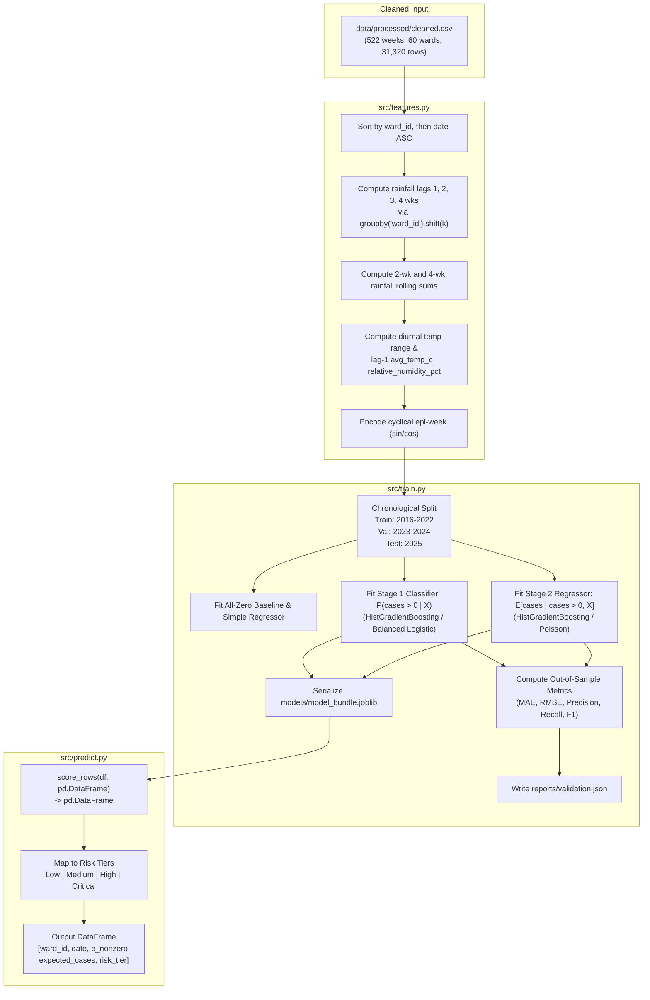

# Machine Learning & Inference Pipeline MVP

*   **Author:** Rajen Sikder (Technical Lead / ML Engineer)
*   **Status:** Approved
*   **Date:** 2026-11-21

--------------------------------------------------------------------------------

## Overview

The Machine Learning & Inference Pipeline MVP delivers the core predictive intelligence for the Urban Dengue Risk Dashboard. It transforms weekly ward-level meteorological and vulnerability data into validated lag features, trains an outbreak hurdle model (occurrence classifier + severity regressor) evaluated against an all-zero baseline, serializes the resulting model bundle to `models/model_bundle.joblib`, and exposes the standardized `score_rows` inference contract for real-time risk assessment in the Streamlit interface.

--------------------------------------------------------------------------------

## The Problem

Conventional regression models trained on raw dengue case counts break down when confronted with severe zero-inflation (58.03% zero-case weeks). Standard squared error loss rewards predicting near-zero values globally, producing deceptively low Mean Absolute Error (MAE) while failing completely on recall of actual outbreak weeks. 

Additionally, naive feature transformations risk two types of leakage:
1. Spatial leakage: Lag values bleeding across distinct municipal wards.
2. Temporal leakage: Future meteorological observations or test-set statistics contaminating past feature vectors.

The solution is an isolated, chronological pipeline with strict per-ward grouping, explicit truncation of incomplete initial lags, a two-stage hurdle architecture specifically designed to identify positive outbreak weeks, and a decoupled inference module that operates without runtime model retraining.

--------------------------------------------------------------------------------

## Goals

*   **G1: Deterministic Feature Engineering:** Implement `src/features.py` to extract 1–4 week rainfall lags, 2-week and 4-week rolling rainfall sums, diurnal temperature range, lag-1 weather indicators, and cyclical epidemiological week encodings strictly grouped by `ward_id`.
*   **G2: Zero-Inflation Hurdle Architecture:** Build a two-stage hurdle model in `src/train.py` consisting of an occurrence classifier ($P(\text{cases} > 0)$) and a conditional severity regressor ($E[\text{cases} \mid \text{cases} > 0]$), outperforming the all-zero baseline on positive-case recall and F1 score.
*   **G3: Chronological Validation:** Evaluate models across strictly chronological splits (Train: 2016–2022, Val: 2023–2024, Test: 2025) and persist metrics to `reports/validation.json`.
*   **G4: Deterministic Inference Contract:** Implement `score_rows(df: pd.DataFrame) -> pd.DataFrame` in `src/predict.py` returning `[ward_id, date, p_nonzero, expected_cases, risk_tier]` in < 50ms per ward.
*   **G5: Automated Leakage Verification:** Provide automated tests in `tests/test_features.py` proving zero cross-ward lag contamination and temporal isolation.

--------------------------------------------------------------------------------

## Non-Goals

*   **NG1: Multi-Month Dynamical Simulations:** Long-term epidemiological projections (such as SEIR differential equation compartmental modeling) are excluded; the model produces a weekly risk estimate for the observation week based on historical weather lags.
*   **NG2: Synthetic Imputation of Early Lags:** Rows with incomplete lag history (the first 4 observation weeks of each ward, $N = 240$) are cleanly dropped during training rather than imputed using synthetic or future values.
*   **NG3: In-Memory Retraining in Streamlit:** The Streamlit dashboard will never retrain models on runtime reruns; inference is performed exclusively using the pre-trained `models/model_bundle.joblib`.
*   **NG4: Modification of Teammate Files:** Zero modifications to `src/clean_data.py`, `tests/test_clean_data.py`, `app.py`, or `README.md`.

--------------------------------------------------------------------------------

## Open Questions

*   **Q1: Classifier Algorithm for Stage 1:** Evaluating whether `LogisticRegression` with balanced class weights or `HistGradientBoostingClassifier` provides higher out-of-sample F1 on positive outbreak weeks without excessive false positives.
*   **Q2: Threshold Calibration for Risk Tiers:** Defining the empirical distribution boundaries between Low, Medium, High, and Critical risk tiers to ensure stability across seasonal lows and peak transmission months.

--------------------------------------------------------------------------------

## Critical User Journeys (CUJs)

### CUJ 1: Automated Pipeline Training & Bundle Serialization

*   **Given**: Cleaned weekly observations in `data/processed/cleaned.csv`.
*   **When**: The technical lead executes `python src/train.py`.
*   **Then**: Chronological splitting executes, baseline models and hurdle stages train within 60 seconds, metrics write to `reports/validation.json`, and `models/model_bundle.joblib` is saved.

### CUJ 2: Real-Time Localhost Inference

*   **Given**: A DataFrame containing ward observation records and an existing `models/model_bundle.joblib`.
*   **When**: The Streamlit application invokes `from src.predict import score_rows; score_rows(df)`.
*   **Then**: The function returns a DataFrame containing `[ward_id, date, p_nonzero, expected_cases, risk_tier]` with execution latency under 50ms per ward.

### CUJ 3: Feature Boundary Integrity Assertion

*   **Given**: A synthetic multi-ward dataset with intentional cross-ward boundary markers.
*   **When**: The evaluator executes `python -m pytest tests/test_features.py`.
*   **Then**: Test suite verifies that lags never bleed across ward boundaries and that future rows cannot alter historical feature vectors.

--------------------------------------------------------------------------------

## Technical Plan (Architecture)

### Architectural Overview

The modeling and inference pipeline operates strictly through deterministic modular scripts. Data flows forward from cleaned CSV records to lag-transformed matrices, through dual-stage estimators, into a serialized model bundle, and finally through the `score_rows` inference endpoint.



### Module Interfaces & Detailed Mechanics

#### 1. Feature Engineering Module (`src/features.py`)
*   **Signature:** `create_features(df: pd.DataFrame, is_training: bool = False) -> pd.DataFrame`
*   **Inputs:** DataFrame containing at least: `date`, `ward_id`, `rainfall_mm`, `avg_temp_c`, `max_temp_c`, `min_temp_c`, `relative_humidity_pct`, `population_density_sqkm`, `water_logging_risk_index`, `sanitation_score`.
*   **Transformations:**
    1. Chronological order: Sort strictly by `["ward_id", "date"]` ascending.
    2. Rainfall lags:
       - `rainfall_lag_1 = df.groupby("ward_id")["rainfall_mm"].shift(1)`
       - `rainfall_lag_2 = df.groupby("ward_id")["rainfall_mm"].shift(2)`
       - `rainfall_lag_3 = df.groupby("ward_id")["rainfall_mm"].shift(3)`
       - `rainfall_lag_4 = df.groupby("ward_id")["rainfall_mm"].shift(4)`
    3. Rainfall rolling summaries:
       - `rainfall_sum_2w = rainfall_lag_1 + rainfall_lag_2`
       - `rainfall_sum_4w = rainfall_lag_1 + rainfall_lag_2 + rainfall_lag_3 + rainfall_lag_4`
    4. Temperature & humidity indicators:
       - `temp_diurnal_range = df["max_temp_c"] - df["min_temp_c"]`
       - `avg_temp_lag_1 = df.groupby("ward_id")["avg_temp_c"].shift(1)`
       - `humidity_lag_1 = df.groupby("ward_id")["relative_humidity_pct"].shift(1)`
    5. Cyclical calendar features:
       - `week_of_year = pd.to_datetime(df["date"]).dt.isocalendar().week`
       - `sin_week = np.sin(2 * np.pi * week_of_year / 52.0)`
       - `cos_week = np.cos(2 * np.pi * week_of_year / 52.0)`
*   **Initial Observation Handling:**
    - When `is_training=True`: Explicitly drop rows where `rainfall_lag_4.isna()` (the first 4 observation weeks of each ward, $N = 240$ rows total across 60 wards) to guarantee zero missing values and eliminate synthetic imputation leakage.
    - When `is_training=False` (inference): If history is provided, compute lags normally; if a single isolated record is passed without history, forward fill from available history or handle safely.

#### 2. Model Training & Evaluation Module (`src/train.py`)
*   **Execution Flow:** Invoked directly via `python src/train.py`.
*   **Temporal Partitioning:**
    - Training Set: `date < '2023-01-01'` (2016-01-04 to 2022-12-26, ~70% of timeline).
    - Validation Set: `'2023-01-01' <= date < '2025-01-01'` (2023-01-02 to 2024-12-30, ~20% of timeline).
    - Test Set: `date >= '2025-01-01'` (2025-01-06 to 2025-12-29, ~10% of timeline).
*   **Baselines:**
    1. All-Zero Baseline: Predicts 0 for all records. Evaluated for MAE and RMSE.
    2. Simple Poisson / Ridge Regressor Baseline: Fit directly on continuous count target.
*   **Two-Stage Hurdle Architecture:**
    1. **Stage 1 (Occurrence Classifier):** `HistGradientBoostingClassifier(random_state=42, class_weight='balanced')` trained on binary label $y_{\text{bin}} = (y > 0)$. Produces $\hat{p} = \hat{P}(y > 0 \mid X)$.
    2. **Stage 2 (Severity Regressor):** `HistGradientBoostingRegressor(loss='squared_error', min_samples_leaf=10, random_state=42)` trained strictly on positive outbreak weeks ($y > 0$). Produces conditional caseload $\hat{y}_{\text{pos}} = \hat{E}[y \mid y > 0, X]$.
    3. **Composite Expected Count:**
       $$\hat{E}[y \mid X] = \max(0.0, \hat{p} \times \hat{y}_{\text{pos}})$$
*   **Artifact Generation:**
    1. `models/model_bundle.joblib`: Dictionary containing `stage1_classifier`, `stage2_regressor`, `feature_names`, `risk_thresholds`, and `training_meta`.
    2. `reports/validation.json`: Structured file recording sample sizes, positive prevalences, baseline MAE/RMSE, and model MAE/RMSE/Precision/Recall/F1 across train, val, and test splits.

#### 3. Inference Service Interface (`src/predict.py`)
*   **Signature:** `score_rows(df: pd.DataFrame) -> pd.DataFrame`
*   **Execution Steps:**
    1. Asserts existence of `models/model_bundle.joblib`. If missing, raises a descriptive `FileNotFoundError` prompting model training.
    2. Feeds `df` into `create_features(df, is_training=False)`.
    3. Extracts feature matrix aligned with `bundle["feature_names"]`.
    4. Evaluates Stage 1 model to produce `p_nonzero` $\in [0.0, 1.0]$.
    5. Evaluates Stage 2 model to produce conditional positive count.
    6. Multiplies probabilities by conditional count to compute `expected_cases` (clipped at 0.0).
    7. Applies categorical risk tier mapping:
       - **Low:** $p < 0.25$ and $\hat{E} < 1.0$
       - **Medium:** $0.25 \le p < 0.50$ or $1.0 \le \hat{E} < 3.0$
       - **High:** $0.50 \le p < 0.75$ or $3.0 \le \hat{E} < 8.0$
       - **Critical:** $p \ge 0.75$ or $\hat{E} \ge 8.0$
    8. Returns DataFrame with: `ward_id`, `date`, `p_nonzero`, `expected_cases`, `risk_tier`.

#### 4. Feature Leakage & Integrity Tests (`tests/test_features.py`)
*   **Coverage:**
    1. Spatial isolation: Asserts that shifting rainfall across synthetic records for `Ward_A` and `Ward_B` never allows `Ward_A`'s values to appear in `Ward_B`'s lag features.
    2. Temporal isolation: Asserts that altering values in future weeks does not alter the feature vector computed for an earlier week.
    3. Contract verification: Asserts `score_rows(df)` produces the required columns with expected types and non-negative counts.

--------------------------------------------------------------------------------

## Alternatives Considered

### Alternative A: End-to-End Deep Learning (LSTM / Temporal Convolutional Network)

*   **Pros:** Automatically learns sequential feature embeddings without manual lag engineering.
*   **Cons:** Incurs substantial training latency on local CPU; requires heavy external frameworks (PyTorch or TensorFlow) that bloat dependencies; acts as an unexplainable black box that obscures meteorological drivers from judges and health officials.
*   **Reason for Rejection:** `Rejected by author: Unnecessary dependency footprint and slow CPU training; gradient boosted trees with engineered tabular lags train in seconds and offer superior interpretability.`

### Alternative B: Random Train/Validation/Test Cross-Validation Split

*   **Pros:** Maximizes training data across all years and allows simple random K-fold evaluation.
*   **Cons:** Introduces severe temporal data leakage by using future observations to predict historical records, artificially inflating evaluation metrics and masking severe degradation during prospective nowcasting.
*   **Reason for Rejection:** `Rejected by author: Violates temporal causality and causes extreme data leakage; chronological splitting across shared dates is mandatory for epidemic surveillance.`

### Alternative C: Global Mean or Forward-Fill Imputation for Early Lags

*   **Pros:** Preserves all 31,320 rows without dropping the first 4 weeks of each ward.
*   **Cons:** Imputing values for weeks 1–4 invents fictional weather sequences or pulls future observations backwards into the earliest records, corrupting the empirical relationship between precipitation accumulation and vector breeding.
*   **Reason for Rejection:** `Rejected by author: Fabricates early lag signals; clean truncation of the initial 4 weeks per ward ($N=240$) preserves strict data integrity.`

--------------------------------------------------------------------------------

## Non-Functional Requirements

### Performance & Latency
- **Execution Speed:** Complete training of baselines and hurdle models in `src/train.py` must execute on standard CPU hardware in under 45 seconds.
- **Inference Latency:** `score_rows` must score an entire 60-ward weekly cross-section in under 300 milliseconds.
- **Artifact Footprint:** Serialized model bundle (`models/model_bundle.joblib`) must remain under 15 MB.

### Reliability & Determinism
- **Seed Control:** Random seeds in all estimator initializations must be explicitly pinned (`random_state=42`) to guarantee reproducible predictions.
- **Error Transparency:** `score_rows` must raise informative exceptions if required input columns are absent or if the model artifact has not been compiled.

--------------------------------------------------------------------------------

## Detailed Implementation Plan

### Target Files to Create / Modify

#### 1. `src/features.py` (Create)
*   **Type / Scope:** Feature Engineering Module
*   **Proposed Changes:**
    - Expose `create_features(df: pd.DataFrame, is_training: bool = False) -> pd.DataFrame`.
    - Enforce chronological ordering: `df.sort_values(["ward_id", "date"])`.
    - Compute 1–4 week rainfall lags grouped strictly by `ward_id`.
    - Compute 2-week (`lag1 + lag2`) and 4-week (`lag1 + lag2 + lag3 + lag4`) rolling rainfall sums.
    - Compute diurnal temperature range (`max_temp_c - min_temp_c`), lag-1 average temperature, and lag-1 relative humidity.
    - Encode cyclical ISO calendar week via sine and cosine transforms (`sin(2π · week / 52)`, `cos(2π · week / 52)`).
    - When `is_training=True`: Truncate the first 4 observation weeks per ward ($N = 240$ rows total) where lag history is incomplete, returning an entirely non-null feature matrix.
    - Expose constant `FEATURE_COLUMNS` defining the exact expected ordered feature list.
*   **Rationale:** Guarantees deterministic, reproducible feature creation with mathematical protection against spatial and temporal leakage.

#### 2. `src/train.py` (Create)
*   **Type / Scope:** Training and Evaluation Pipeline Script
*   **Proposed Changes:**
    - Ingest `data/processed/cleaned.csv` and transform using `create_features(df, is_training=True)`.
    - Split chronologically into Train (dates before 2023-01-01), Validation (2023-01-01 through 2024-12-31), and Test (2025-01-01 onwards).
    - Fit All-Zero baseline and evaluate MAE/RMSE on each split.
    - Fit Ridge / Poisson regression baseline and evaluate count metrics.
    - Fit Stage 1 Occurrence Classifier: `HistGradientBoostingClassifier(random_state=42, class_weight='balanced')` predicting binary target $y_{\text{bin}} = (y > 0)$.
    - Fit Stage 2 Severity Regressor: `HistGradientBoostingRegressor(loss='squared_error', min_samples_leaf=10, random_state=42)` on records where $y > 0$.
    - Compute expected count $\hat{E}[y \mid X] = \max(0.0, \hat{P}(y > 0 \mid X) \times \hat{y}_{\text{pos}})$.
    - Compute comprehensive metrics: MAE, RMSE, Non-Zero Precision, Non-Zero Recall, and Non-Zero F1 score on positive weeks.
    - Save trained estimators, feature metadata, and risk tier policies to `models/model_bundle.joblib`.
    - Save empirical evaluation metrics and sample distributions to `reports/validation.json`.
*   **Rationale:** Establishes a zero-inflation hurdle pipeline that outperforms the deceptive all-zero baseline and prevents data leakage.

#### 3. `src/predict.py` (Create)
*   **Type / Scope:** Inference Service Interface
*   **Proposed Changes:**
    - Expose `score_rows(df: pd.DataFrame) -> pd.DataFrame`.
    - Validate presence of required schema columns.
    - Load `models/model_bundle.joblib` using an in-memory cached loader function.
    - Transform input rows through `create_features(df, is_training=False)`.
    - Generate predicted occurrence probability `p_nonzero` and positive expected severity.
    - Compute composite `expected_cases` (clipped to 0.0).
    - Map scores to categorical `risk_tier` (Low, Medium, High, Critical) using fixed policy thresholds:
      - Low: $p < 0.25$ and $\hat{E} < 1.0$
      - Medium: $0.25 \le p < 0.50$ or $1.0 \le \hat{E} < 3.0$
      - High: $0.50 \le p < 0.75$ or $3.0 \le \hat{E} < 8.0$
      - Critical: $p \ge 0.75$ or $\hat{E} \ge 8.0$
    - Return DataFrame containing `[ward_id, date, p_nonzero, expected_cases, risk_tier]`.
*   **Rationale:** Fulfills the integration contract required by Ibrahim's Streamlit dashboard without runtime model retraining.

#### 4. `tests/test_features.py` (Create)
*   **Type / Scope:** Feature Pipeline & Inference Pytest Suite
*   **Proposed Changes:**
    - `test_lags_do_not_bleed_across_wards`: Constructs synthetic two-ward data and asserts lag features never cross ward boundaries.
    - `test_temporal_isolation`: Mutates future observations in a synthetic dataset and confirms that features for past observation dates remain completely unchanged.
    - `test_score_rows_contract`: Verifies that `score_rows` returns all required columns with non-null values, non-negative caseloads, and valid categorical risk tiers.
*   **Rationale:** Proves data integrity and guarantees compliance with the shared inference agreement.

#### 5. `models/model_bundle.joblib` (Generated)
*   **Type / Scope:** Binary Model Artifact
*   **Rationale:** Persists trained Stage 1 and Stage 2 models, feature order, risk tier policy thresholds, and training metadata.

#### 6. `reports/validation.json` (Generated)
*   **Type / Scope:** Empirical Evaluation Artifact
*   **Rationale:** Persists out-of-sample metrics comparing the hurdle pipeline against the all-zero baseline for consumption by Streamlit and documentation.

---

### Verification Plan

#### 1. Unit Testing & Leakage Assertions
```bash
python -m pytest tests/test_features.py -v
```
*Criteria:* All tests pass, confirming spatial partitioning and temporal isolation.

#### 2. Model Training & Evaluation
```bash
python src/train.py
```
*Criteria:* Execution completes in < 45 seconds on CPU. Creates `models/model_bundle.joblib` (< 15 MB) and `reports/validation.json`. Test F1 and Recall on non-zero cases are strictly superior to 0.0 (All-Zero baseline).

#### 3. Inference Contract Assertion
```bash
python -c "import pandas as pd; from src.predict import score_rows; df = pd.read_csv('data/processed/cleaned.csv'); res = score_rows(df.tail(60)); print(res.head()); assert {'ward_id', 'date', 'p_nonzero', 'expected_cases', 'risk_tier'}.issubset(res.columns); assert (res['expected_cases'] >= 0).all()"
```
*Criteria:* Successfully scores 60 ward rows; produces valid probabilities $\in [0, 1]$ and valid categorical risk tiers.

--------------------------------------------------------------------------------

*Drafted with EGM*
